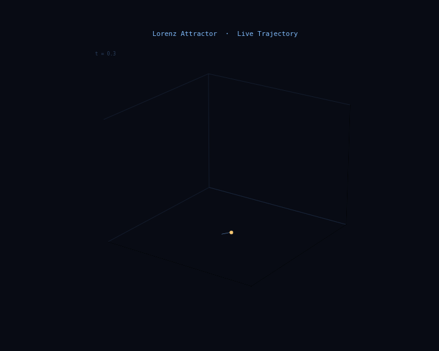

<div align="center">

# The Art of Chaos

*A hands-on notebook on chaos theory, dynamical systems, and fractals.*

[](https://python.org)
[](https://jupyter.org)
[](https://numpy.org)
[](https://scipy.org)
[](LICENSE)

</div>

Chaos theory studies systems that follow fixed rules but are still impossible to predict in practice. A tiny change in the starting conditions grows until it changes the outcome completely. The material is split across two notebooks so each one renders quickly on GitHub: [Part 1](the-art-of-chaos-part1.ipynb) covers sections 1 to 4, and [Part 2](the-art-of-chaos-part2.ipynb) covers sections 5 to 8.

Everything is computed from the equations. No images are downloaded or reused.

## Contents

| Part | Section | Topic |
|:---:|:---|:---|
| 1 | 1. The Butterfly Effect | The Lorenz attractor from 80,000 points |
| 1 | 2. Strange Attractor Gallery | Six systems with very different geometry |
| 1 | 3. The Road to Chaos | Bifurcation diagram and Feigenbaum's constant |
| 1 | 4. The Mandelbrot Set | One rule, detail at every scale |
| 2 | 5. Julia Set Gallery | Eight constants, eight fractals |
| 2 | 6. Lyapunov Exponents | Measuring how fast nearby paths separate |
| 2 | 7. Animated Lorenz Attractor | A 200 frame rotating view |
| 2 | 8. Poincaré Sections | Slicing an orbit to reveal its structure |

---

## 1. The Butterfly Effect

In 1963 Edward Lorenz reran a weather simulation after rounding one input from 0.506127 to 0.506. The model was unchanged, the difference was invisible, and the forecast came out completely different. That result is where the modern study of chaos begins.

The notebook integrates the Lorenz system:

```
dx/dt = sigma (y - x)        sigma = 10
dy/dt = x (rho - z) - y      rho = 28
dz/dt = x y - beta z         beta = 8/3
```

The trajectory is computed at 80,000 points and coloured by time. It never repeats and never crosses itself, even though three fixed equations determine every step.

The interesting part is that the system is deterministic and still unpredictable. Two starting points that differ by 0.0000001 follow almost the same path at first, then separate exponentially until they have nothing in common. This is a property of the equations, not a limit of the simulation.

---

## 2. Strange Attractor Gallery

The notebook renders five more systems alongside Lorenz, each with its own parameters and viewing angle:

| Attractor | Year | Notes |
|:---|:---:|:---|
| Lorenz | 1963 | The original chaotic system, from a simplified weather model |
| Rössler | 1976 | A simpler spiral with one nonlinear term |
| Halvorsen | | Symmetric equations that produce sweeping loops |
| Aizawa | | A torus-like structure with dense internal detail |
| Dadras | | A folded ribbon of a trajectory |
| Thomas | | Sinusoidal feedback that builds a labyrinth |

These are fractal objects. Their detail continues at every zoom level, and their fractal dimension falls between 2 and 3. The Lorenz attractor, for example, has a dimension of about 2.06, so it behaves like something more than a surface and less than a solid.

---

## 3. The Road to Chaos

The logistic map is the simplest system that shows the shift from order to chaos:

```
x[n+1] = r * x[n] * (1 - x[n])
```

One equation, one parameter. As r increases, the behaviour changes in a fixed sequence:

```
r below 3.0    steady state
r around 3.45  period 2
r around 3.54  period 4
r around 3.57  periods 8, 16, 32, and so on
r above 3.57   chaos
```

The diagram uses 1,680,000 points. The interval between each split shrinks by a constant factor, which is Feigenbaum's constant, delta = 4.669201609. The same value appears in every smooth one-dimensional map that reaches chaos this way. It is one of those results that is easy to state and hard to believe.

---

## 4. The Mandelbrot Set

Each point c in the complex plane is tested with one rule:

```
z[n+1] = z[n]^2 + c
```

If the sequence stays bounded, the point belongs to the set. The rule is a single line of code, but the border between the bounded and unbounded regions keeps producing new structure at every scale the notebook reaches. The deepest view uses up to 1,024 iterations per pixel.

The set has a finite area, about 1.506484, while its boundary has infinite length. That combination is why it is usually described as a simple rule with complicated consequences.

---

## 5. Julia Set Gallery

Every point c in the Mandelbrot set pairs with its own Julia set, built with the same iteration. The notebook renders eight of them:

| c | Appearance |
|:---|:---|
| −0.7269 + 0.1889i | Branching spiral |
| −0.4 + 0.6i | The Douady rabbit |
| 0.285 + 0.013i | Islands close to a circle |
| −0.835 − 0.2321i | The San Marco fractal |
| −0.8 + 0.156i | A connected swirl |
| −0.7 + 0.27015i | Siegel disk |
| 0.0 + 0.8i | Branching filaments |
| −0.123 + 0.745i | A ring structure |

When c is inside the Mandelbrot set the Julia set is one connected piece. When c is outside, it breaks apart into disconnected points.

---

## 6. Lyapunov Exponents

The Lyapunov exponent measures how quickly two nearby trajectories separate:

```
lambda = limit as n grows of (1/n) * sum of ln|f'(x[i])|
```

| Value | Meaning |
|:---:|:---|
| lambda below 0 | Nearby paths converge, so the behaviour is ordered |
| lambda equal to 0 | Neutral stability, the edge between the two |
| lambda above 0 | Nearby paths diverge, so the behaviour is chaotic |

The notebook maps lambda over a 900 by 900 grid of parameter pairs for the Zircon City map, which comes to 810,000 points. Regions with a positive exponent are chaotic. The contour where lambda equals zero traces the boundary between predictable and unpredictable behaviour.

---

## 7. Animated Lorenz Attractor

The animation follows the same Lorenz solution over 200 frames. A gold marker shows the current position, a blue trail shows where it has been, and the camera rotates slowly around the attractor.

GitHub does not run the JavaScript inside notebook outputs, so the animation is stored in the repository as a GIF and embedded here. It plays directly on this page.



The cell in Part 2 regenerates the file at `animations/lorenz_attractor.gif`. Rendering takes roughly 30 to 60 seconds, which is expected. If the animation does not appear when you run all cells, run that cell on its own.

---

## 8. Poincaré Sections

A Poincaré section records where a trajectory crosses a chosen plane. Here the plane is z = 27, taken from a solution of 500,000 points. The pattern of crossings shows what kind of motion is happening:

```
periodic orbit     a few points
quasi-periodic     a closed curve
chaotic orbit      a fractal cloud
```

The return map plots one crossing against the next. The points settle along a curve instead of scattering, which shows that even a chaotic orbit keeps a deterministic structure. Poincaré introduced the technique in 1890, well before computers existed.

---

## Quick Start

```bash
# clone the repository
git clone https://github.com/nachiket-1/The-Art-of-Chaos-Dynamical-Systems-Fractals.git
cd The-Art-of-Chaos-Dynamical-Systems-Fractals

# install the dependencies
pip install numpy matplotlib scipy jupyter

# run part one
jupyter notebook the-art-of-chaos-part1.ipynb

# and part two
jupyter notebook the-art-of-chaos-part2.ipynb
```

---

## What Was Computed

| Quantity | Value |
|:---|:---|
| Lorenz trajectory points | 80,000 |
| Bifurcation diagram points | 1,680,000 |
| Mandelbrot iterations per pixel | up to 1,024 |
| Julia sets rendered | 8 |
| Lyapunov grid | 900 by 900, or 810,000 points |
| Poincaré crossings | about 5,000 |
| Animation frames | 200 |
| Python code | about 400 lines |
| External images used | none |

Every figure in the notebook comes from the code beside it.

---

## Notes on the Mathematics

Three ideas are worth keeping after the plots are gone.

**Determinism is not predictability.** The Lorenz equations contain no randomness at all. The weather a month out is still unknowable, because any error in our reading of the present grows exponentially with time.

**Complex behaviour does not need complex rules.** The Mandelbrot set comes from one line, repeated. A great deal of structure in nature may come from the same kind of repetition rather than from complicated machinery.

**The route into chaos is organised.** Feigenbaum's constant is the same across unrelated systems. The boundary between order and chaos has rules of its own.

---

## Further Reading

| Book | Author | Why it is worth your time |
|:---|:---|:---|
| Chaos | James Gleick | The narrative history of the field, written for a general reader |
| The Fractal Geometry of Nature | Benoit Mandelbrot | The original argument, in Mandelbrot's own words |
| Nonlinear Dynamics and Chaos | Steven Strogatz | The standard textbook, rigorous but readable |
| Does God Play Dice | Ian Stewart | The philosophy and the mathematics together |

---

<div align="center">

*Built with Python, NumPy, SciPy, and Matplotlib.*

</div>
